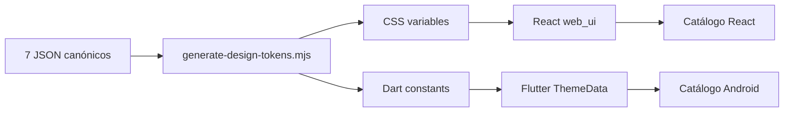

# Componentes — Fase 0.6

Estado: implementación técnica completa y aprobada formalmente por el propietario.

Fecha: 2026-10-29.

Rama local: `feature/phase-0.6-design-components` (no publicada).

## Alcance y límites

Esta fase convierte los patrones aprobados de los 46 mockups en componentes
visuales reutilizables. No implementa autenticación, pedidos, cobros, impresión,
NFC/QR, persistencia, backend ni integraciones. Los estados `pending` y
`confirmed` son exclusivamente visuales; ninguna mutación queda confirmada sin
ACK del servidor.

La fuente canónica continúa siendo `design/tokens/`. El script
`scripts/generate-design-tokens.mjs` genera los adaptadores CSS y Dart. Los siete
JSON y las cuatro referencias visuales no fueron modificados.

## Flujo de tokens



Los adaptadores cubren colores de los cuatro temas, escala tipográfica,
espaciado, radios, elevación, movimiento, foco y objetivo táctil. Los valores
específicos continúan sujetos a validación visual, como indican los metadatos de
los tokens aprobados.

## Inventario React

Ubicación: `packages/web_ui/`. Todas las propiedades están tipadas con
TypeScript y se exportan desde `src/index.ts`.

| Componente | Propiedades o variantes principales | Estados | Tokens y consumo previsto |
|---|---|---|---|
| `RestaurantButton` | `variant`, `loading`, `icon`, atributos HTML | normal, hover, pressed, focus, disabled, loading | colores, 48 px, radio, movimiento; acciones en los cinco entornos React |
| `RestaurantIconButton` | `label`, `icon`, `selected` | normal, selected, focus, disabled | 48 px, foco; barras y acciones compactas |
| `RestaurantCard` | `elevated`, `selected`, elemento semántico | normal, elevated, selected | superficie, borde, radio, elevación; paneles y tarjetas |
| `KpiCard` | `label`, `value`, `detail`, `trend`, `tone` | neutral y tonos semánticos | tipografía tabular, color; ADM-02 y reportes |
| `DataTable<Row>` | columnas tipadas, filas, caption, mensaje vacío | datos, vacío | espaciado, borde, tipografía; administración |
| `FormField` | `label`, `htmlFor`, `hint`, `error`, `required` | normal, error | tipografía y peligro; formularios |
| `TextField` | propiedades de input más label/hint/error | normal, focus, disabled, validation | 48 px, foco, borde; administración y POS |
| `SelectField` | opciones tipadas más label/hint/error | normal, focus, disabled, validation | 48 px, foco; filtros y formularios |
| `FormSection` | `title`, `description`, contenido | normal | espaciado y jerarquía; configuración |
| `HorizontalNavigation` | items, `activeId`, `onChange`, label | normal, active, focus | navegación superior aprobada; administración |
| `CompactRail` | items, `activeId`, `onChange`, label | normal, active, focus | rail lateral aprobado; POS |
| `Modal` | open, labels, destructive, pending, callbacks | normal, pending, destructive | superficies, elevación, foco; confirmaciones visuales |
| `Alert` | `title`, `tone`, acción | neutral, success, warning, danger | colores semánticos; todos los entornos |
| `EmptyState` | título, descripción, icono, acción | vacío | tipografía y espaciado; listas y tableros |
| `ConnectionStatus` | `online`, `offline`, `reconnecting` | tres estados explícitos | estado no dependiente solo del color |
| `LoadingIndicator` | label, inline | loading | movimiento reducido y label accesible |
| `KdsOrderCard` | ticket, mesa, tiempo, items, nota, status, ACK | pending, preparing, ready, pending ACK | `kitchen-dark`, 48 px; KDS-01 a KDS-07 |
| `KitchenColumn` | título, conteo, tono | accent, warning, success | superficie oscura; tablero KDS |
| `TableCard` | número, status, detail, tone, selected | normal, selected | estado textual y color; administración y POS |
| `PaymentOption` | título, descripción, icono, selected, disabled, badge | normal, selected, disabled | 48 px, foco; POS-03 sin operación financiera |
| `AccountSummary` | mesa, líneas, subtotal, propina, total, actualización | informativo | números tabulares; resumen persistente POS |
| `TipIndicator` | valor, state, voluntary | unregistered, pending, confirmed | warning/success con texto; POS-05/06 |

### Ejemplo React

```tsx
import { ConnectionStatus, RestaurantButton } from '@restaurant-os/web-ui';
import '@restaurant-os/web-ui/styles.css';

export function Example() {
  return (
    <section data-theme="admin-light">
      <ConnectionStatus state="online" detail="Servidor disponible" />
      <RestaurantButton variant="primary">Guardar borrador</RestaurantButton>
    </section>
  );
}
```

El consumidor es responsable de orquestar permisos, red, ACK y datos. El botón
no guarda ni confirma por sí mismo.

## Inventario Flutter

Ubicación: `packages/flutter_design_system/`. Los widgets se exportan desde
`lib/flutter_design_system.dart` y reciben `ThemeData` construido por
`RestaurantTheme`.

| Widget | Propiedades o variantes principales | Estados | Tokens y consumo previsto |
|---|---|---|---|
| `RestaurantButton` | label, callback, icon, loading, variant | normal, pressed, disabled, loading | 48 dp, colores y radios; cliente/mesero |
| `RestaurantTextField` | controller, label, hint, error, enabled | normal, focus, disabled, validation | 48 dp y semántica; accesos/formularios |
| `RestaurantCard` | child, padding, selected, callback | normal, selected | superficie, borde, radio; contenido táctil |
| `RestaurantHeader` | title, subtitle, leading, trailing | normal | jerarquía tipográfica; tableta/mesero |
| `MenuCategoryChip` | label, selected, callback | normal, selected | 48 dp, pill; TAB-03/04 |
| `ProductCard` | name, description, price, image placeholder, callback | normal, unavailable | tarjeta gastronómica; TAB-03 a TAB-06 |
| `CartSummary` | itemCount, totalLabel, callback, pending | normal, pending ACK | números tabulares y estado textual; TAB-07/08 |
| `RestaurantBottomNavigation` | items, currentIndex, callback | normal, selected | 48 dp y labels; cliente/mesero |
| `RestaurantEmptyState` | title, message, icon, action | vacío | semántica y jerarquía; listas |
| `RestaurantErrorMessage` | title, message, retry | error | danger más texto; fallos recuperables |
| `RestaurantLoadingIndicator` | label | loading | label semántico; carga |
| `RestaurantAlert` | title, message, tone | neutral, success, warning, danger | estado no dependiente solo del color |
| `showRestaurantConfirmationDialog` | context, título, mensaje, labels, destructive | confirmación, cancelación | modal táctil; no ejecuta negocio |
| `RestaurantTableCard` | table, detail, state, callback | available, active, attention, ready | estados textuales; WAI-02/03 |
| `AttentionRequestCard` | table, message, state, callback | new, pending ACK, acknowledged | alerta y ACK explícito; WAI-06 |
| `OrderStatusBadge` | label, state | draft, pending ACK, confirmed, preparing, ready, error | texto + iconografía; TAB/WAI seguimiento |

### Ejemplo Flutter

```dart
MaterialApp(
  theme: RestaurantTheme.customerWarm,
  home: RestaurantButton(
    label: 'Agregar al carrito',
    onPressed: () {}, // El controlador externo solicita la operación.
  ),
)
```

## Catálogos visuales

- React: `packages/web_ui/catalog/`; Vite genera `packages/web_ui/dist/`.
  Permite cambiar entre los cuatro temas y muestra estados normales, foco,
  selección, carga, error, desconexión y ACK pendiente.
- Flutter Android: `packages/flutter_design_system/example/`. Permite alternar
  `customer-warm` y `admin-light`, y muestra acciones, contenido y feedback con
  datos ficticios.

No se usa backend, persistencia, WebSocket ni recursos HTTP externos. No se creó
Flutter Web. El catálogo se compiló, instaló y verificó en un dispositivo
Android 16/API 36; la evidencia nativa se conserva en
`design/validation/phase-0.6/table-kiosk-android-2026-10-29.png`.

## Accesibilidad

- Objetivo mínimo de 48 px/dp derivado de `components.json`.
- Foco visible y navegación nativa por teclado en controles React.
- Labels, `aria-live`, estados pressed/selected y elementos HTML semánticos.
- `Semantics`, labels y widgets Material accesibles en Flutter.
- Estados críticos incluyen texto e iconografía; no dependen solo del color.
- CSS anula duraciones bajo `prefers-reduced-motion: reduce`.
- Los componentes no anuncian éxito de pedido, cobro o cierre sin que el
  consumidor les entregue un estado confirmado por servidor.

## Pruebas y validaciones

React tiene 10 pruebas de renderizado, interacción, selección, estados, tabla,
modal y ACK visual. Flutter tiene 7 pruebas de widgets, temas, semántica y
dimensiones táctiles. `scripts/validate-phase-0.6.mjs` comprueba tokens,
adaptadores, inventarios, accesibilidad estructural, ausencia de red y la
integridad de referencias/capturas.

Resultados reales del 2026-10-29:

| Comando | Resultado |
|---|---|
| `pnpm --filter @restaurant-os/web-ui typecheck` | correcto |
| `pnpm --filter @restaurant-os/web-ui lint` | correcto |
| `pnpm --filter @restaurant-os/web-ui test` | 10/10 pruebas correctas |
| `pnpm --filter @restaurant-os/web-ui build` | correcto, 39 módulos transformados |
| `flutter analyze` (paquete) | correcto, sin incidencias |
| `flutter test` (paquete) | 7/7 pruebas correctas |
| `flutter analyze` (ejemplo Android) | correcto, sin incidencias |
| `flutter build apk --debug --suppress-analytics` | correcto fuera del sandbox restringido; APK verificado por SHA-256 |
| `flutter run --debug --no-resident --suppress-analytics` | correcto en dispositivo Android físico |
| Validadores Fases 0.1, 0.3, 0.4 Entrega 2 y 0.5 | correctos |
| Builds admin/KDS/POS y typecheck API | correctos |
| Analyze/test de `apps/table_kiosk` | correctos, 1/1 prueba |
| `pnpm peers check` | aviso conocido: `schema-utils@4.8.1` solicita webpack `^5.112.0`; instalado `5.106.2` |

Durante la implementación, TypeScript detectó importaciones incompatibles con
la resolución NodeNext, ESLint detectó un handler no semántico en el modal y
tres pruebas Flutter detectaron semántica duplicada/entrada incorrecta. Se
corrigieron antes de la matriz final. El validador histórico de Fase 0.1 también
se actualizó para comprobar el adaptador Dart generado en vez de exigir colores
duplicados manualmente. No se relajó la comparación de valores.

Comandos reproducibles:

```powershell
node scripts/generate-design-tokens.mjs
pnpm --filter @restaurant-os/web-ui typecheck
pnpm --filter @restaurant-os/web-ui lint
pnpm --filter @restaurant-os/web-ui test
pnpm --filter @restaurant-os/web-ui build
cd packages/flutter_design_system
flutter analyze
flutter test
cd example
flutter analyze
node scripts/validate-phase-0.6.mjs
```

## Dependencias nuevas y licencias

No se incorporaron dependencias productivas externas adicionales a React,
Flutter y los paquetes del workspace ya seleccionados. Las herramientas de
desarrollo resueltas localmente son:

| Paquete | Versión resuelta | Licencia declarada |
|---|---:|---|
| `@eslint/js` | 9.39.5 | MIT |
| `@testing-library/jest-dom` | 6.10.0 | MIT |
| `@testing-library/react` | 16.3.3 | MIT |
| `@types/react`, `@types/react-dom` | 19.3.0 | MIT |
| `@vitejs/plugin-react` | 4.7.0 | MIT |
| `eslint` | 9.39.5 | MIT |
| `eslint-plugin-jsx-a11y` | 6.10.2 | MIT |
| `eslint-plugin-react-hooks` | 7.1.1 | MIT |
| `jsdom` | 26.1.0 | MIT |
| `react`, `react-dom` | 19.3.1 | MIT |
| `typescript` | 5.9.3 | Apache-2.0 |
| `typescript-eslint` | 8.72.1 | MIT |
| `vite` | 6.4.5 | MIT |
| `vitest` | 3.2.7 | MIT |
| `flutter_lints` | 6.x | BSD-3-Clause |

Los paquetes se usan bajo sus propias licencias. El repositorio no tiene aún
una licencia open source aprobada y sigue sin autorizar la redistribución de las
cuatro referencias privadas; ninguna se incluye en el paquete público de esta
fase.

## Decisiones y pendientes

1. Conservar acceso de escritura a la caché de Flutter al automatizar builds en sandboxes restringidos.
2. Integrar la fase solo mediante Pull Request revisado, sin reescribir historial.
3. No ajustar los valores concretos de tokens hasta recibir aprobación.
4. Mantener cualquier política comercial/fiscal fuera de los componentes.

Fase 0.7 no iniciada.
