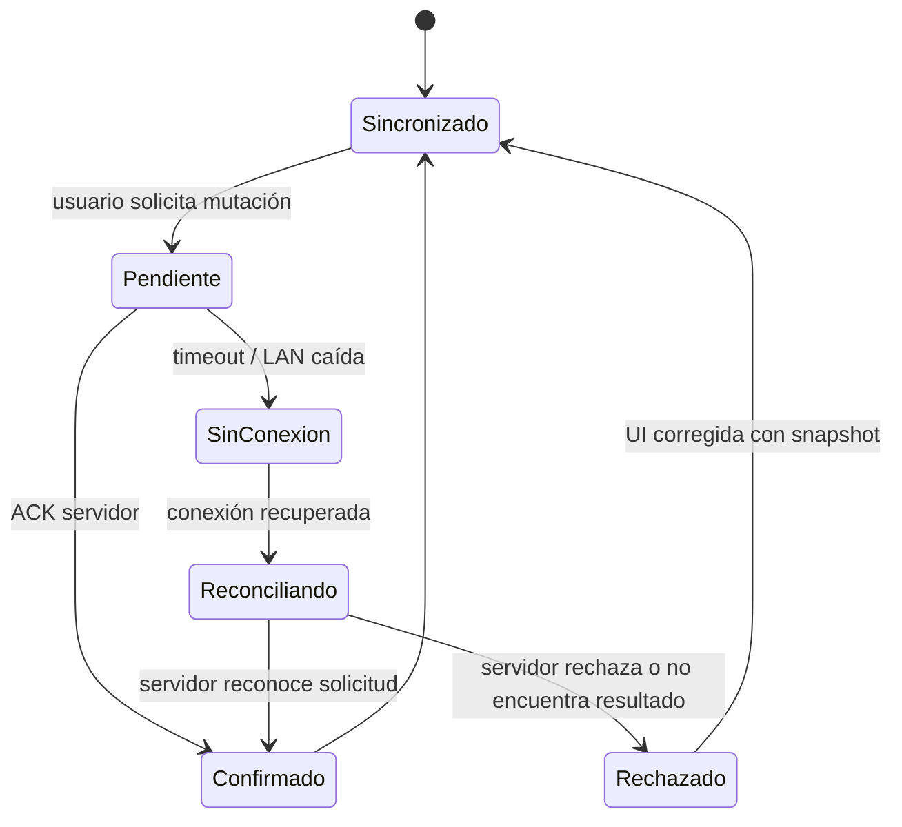

# Estados UX y recuperación — Fase 0.2

## Regla de confirmación

Un pedido, una transición de cocina, un pago, una propina, un ticket, una mesa, un turno o una caja **no está confirmado** hasta recibir ACK/version del backend. El cliente puede mostrar una solicitud en curso, pero nunca convertirla visualmente en éxito por una animación, timeout o persistencia local.

## Estados obligatorios por interfaz

| Estado | Administración / gerente | Mesero | Tableta cliente | KDS | POS |
| --- | --- | --- | --- | --- | --- |
| Carga | skeleton de tarjetas/listas; mantiene filtro | salón/mesa en carga | menú o estado con skeleton | columnas/tarjetas placeholder | cuenta/resumen placeholder |
| Vacío | explica ausencia y acción autorizada | área sin mesas/solicitudes | categoría sin productos disponibles | estación sin tickets | sin cuentas/caja sin movimientos |
| Error | causa legible + reintento/cancelar | no modifica mesa local | no oculta carrito local | no mueve tarjeta | no altera importe/pago |
| Sin conexión | banner persistente; datos con hora | bloquear mutaciones no confirmables | catálogo cacheado solo visual | tablero marcado desactualizado | bloquear cobro/cierre no confirmable |
| Reconexión | refrescar snapshots afectados | recargar salón/mesa | consultar resultado del último intento | recuperar eventos/snapshot por estación | reconciliar cuenta/pago/turno desde servidor |
| Operación pendiente | botón bloqueado con identificador de solicitud | mesa/orden “enviando” | pedido/atención “pendiente de ACK” | transición en espera | cobro/cierre “pendiente, no confirmado” |
| Operación confirmada | toast/estado con versión nueva | snapshot actualizado | estado del pedido actualizado | tarjeta en columna ACK | recibo/pago/cierre solo tras ACK |
| Sesión expirada | volver a login; descartar datos sensibles | volver a login; no enviar borrador | cerrar sesión pública y volver a bienvenida | bloquear acciones y reautenticar | bloquear acciones y reautenticar |
| Permiso insuficiente | destino/acción no disponible | acción de mesa deshabilitada con explicación | nunca se muestra ruta administrativa | estación/acción no visible | operación crítica rechazada y auditada |
| Acción cancelada | cerrar modal y conservar formulario no enviado | volver a detalle | volver a carrito sin cambio | volver a tablero sin transición | volver a cuenta sin crear pago |
| Error de validación | campo, causa y corrección | dato de pedido/movimiento señalado | modificador o carrito señalado | transición inválida explicada | importe/arqueo/propina señalado |
| Conflicto simultáneo | mostrar versión nueva y diferencias | mesa/sesión actualizada | producto/disponibilidad actualizado | ticket cambiado por otro operador | saldo/caja cambió; refrescar |

## Detalle de conectividad

- **Tableta:** solo mantiene menú y carrito visual local. Tras reconexión consulta el resultado de la clave de idempotencia antes de permitir reintento.
- **KDS:** indica la última sincronización y vuelve a pedir snapshot de estación; no usa el color como única señal de conectividad.
- **POS:** no habilita confirmación, ticket ni cierre si falta ACK; muestra una contingencia humana cuando el servidor no responde.
- **Web administrativa/mesero:** refresca recursos que tengan versión; no reenvía automáticamente cambios de formularios sin informar.

## Mensajería y accesibilidad

- Los errores nombran la acción, causa conocida y siguiente paso: `No se confirmó el cobro; verifica la conexión y consulta el estado antes de reintentar`.
- Éxito, error, prioridad y conexión usan texto/icono además de color; los lectores de pantalla reciben anuncios no intrusivos de estado.
- Controles táctiles alcanzan 48 dp y el foco permanece visible tras modal, error o reconexión.
- La acción de reintentar mantiene la idempotencia original cuando el servidor pueda haber recibido la solicitud; “crear otro” exige una nueva intención explícita.

## Datos no confirmados

| Recurso | Antes de ACK | Después de ACK | Si falla/reintenta |
| --- | --- | --- | --- |
| Pedido | carrito sigue editable según regla; etiqueta pendiente | número/estado servidor | consultar por clave idempotente |
| Pago efectivo | importe capturado, sin recibo | movimiento y recibo habilitados | no duplicar; reconciliar por clave |
| Propina | propuesta separada | registro independiente | conservar borrador marcado sin registrar |
| Mesa/turno/caja | solicitud pendiente | estado/version nuevo | recuperar snapshot y explicar conflicto |
| Ticket | cola solicitada | estado de impresión confirmado | pago no se revierte; reintento autorizado |
