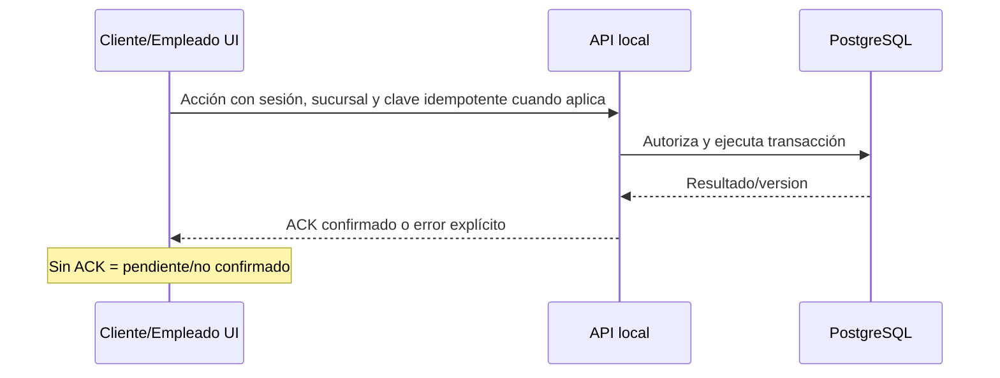

# Flujos de usuario — Fase 0.2

## Convenciones

- **MVP**: recorrido planeado para la primera versión. **POSTERIOR**: interfaz prevista, sin implementación actual.
- Todos los pasos de mutación terminan en `pendiente de ACK`; solo el ACK del backend permite mostrar `confirmado`.
- Cada flujo indica actor, entrada, recorrido, resultado, variantes/errores y permiso. Las reglas comerciales/fiscales no definidas no se inventan.

## Identidad, configuración y turnos

### F-01 — Inicio y cierre de sesión de empleados — MVP

- **Actor/entrada:** administrador, gerente, cajero, mesero, chef o auxiliar con cuenta activa; pantalla de acceso.
- **Recorrido:** ingresar credenciales → validar contra servidor LAN → cargar roles por sucursal → seleccionar sucursal solo si hay más de una autorizada → abrir destino inicial por rol. Cierre: solicitar salir → invalidar sesión servidor → borrar contexto sensible local → volver a acceso.
- **Resultado:** navegación limitada por rol, sucursal y dispositivo; auditoría de inicio/cierre. **Errores:** credenciales inválidas, cuenta bloqueada, servidor inaccesible o sesión vencida se expresan sin revelar datos sensibles. **Permiso:** autenticación válida; el cierre propio no requiere permiso adicional.

### F-02 — Apertura y cierre de turnos — MVP básico

- **Actor/entrada:** empleado autorizado en su sucursal; turno inexistente para apertura, turno activo propio para cierre.
- **Recorrido:** consultar turno actual → revisar hora/rol/sucursal → solicitar apertura o cierre → estado pendiente → ACK. El cierre muestra resumen de datos disponibles y solicita confirmación consciente.
- **Resultado:** turno abierto/cerrado y auditado. **Variantes:** intento de segundo turno activo, turno ajeno o conflicto de versión se rechaza y muestra el snapshot vigente. **Permiso:** `shifts.open`/`shifts.close` configurable; la política de tolerancias y horarios queda pendiente.

### F-03 — Configuración de restaurante y empleados — MVP

- **Actor/entrada:** administrador o gerente con `employees.manage`/ajustes concedidos; módulo Personal o Ajustes.
- **Recorrido:** elegir entidad → ver lista filtrada por sucursal → abrir formulario → validar campos → revisar cambios → enviar → ACK → volver a detalle actualizado.
- **Resultado:** configuración o empleado persistido/auditado. **Variantes:** rol insuficiente oculta acción y el servidor rechaza URL directa; modificación simultánea muestra conflicto y permite recargar/cancelar. **Permiso:** solo los explícitos por operación; no se presupone que gerente administre toda la organización.

### F-04 — Creación y modificación de productos — MVP

- **Actor/entrada:** administrador/gerente con `menu.manage`; categoría o catálogo existente.
- **Recorrido:** abrir Menú → categoría → nuevo producto o edición → capturar descripción, disponibilidad, precio, modificadores, ingredientes/alérgenos y horario configurado → validación → revisión → enviar → ACK.
- **Resultado:** catálogo actualizado para sucursal con confirmación y auditoría; pedidos previos conservan snapshot de precio. **Errores:** datos incompletos, precio/regla fiscal pendiente o conflicto bloquean guardado y conservan borrador. **Permiso:** `menu.manage`; no elimina historial de ventas.

## Salón, cliente y pedido

### F-05 — Apertura de mesa — MVP

- **Actor/entrada:** mesero autorizado o personal administrativo/supervisor; mesa disponible y sucursal/área válida.
- **Recorrido:** salón → mesa → revisar estado y versión → abrir sesión → pendiente ACK → servidor verifica que no exista otra sesión activa → mostrar sesión ocupada y mesa asignada.
- **Resultado:** una sola `table_session` activa y estado coherente. **Errores:** mesa reservada/bloqueada/fuera de servicio, sesión ya existente, desconexión o conflicto muestran causa y no cambian la UI a ocupada. **Permiso:** `tables.open` y, si aplica, asignación de mesero.

### F-06 — Acceso como cliente invitado — MVP

- **Actor/entrada:** dispositivo ya vinculado y sesión de mesa autorizada.
- **Recorrido:** bienvenida → idioma → `Continuar como invitado` → crear/recuperar guest de sesión mediante servidor → entrar a menú. No se pide PII para navegar.
- **Resultado:** identidad de consumo limitada a esa mesa/sesión. **Errores:** dispositivo sin vínculo, mesa sin sesión o servidor no disponible llevan a pantalla segura sin menú transaccional. **Permiso:** no es rol administrativo; el dispositivo solo puede actuar sobre su sesión.

### F-07 — Identificación futura mediante NFC/QR — POSTERIOR

- **Actor/entrada:** cliente y dispositivo vinculado, lector/hardware aprobado, servidor disponible.
- **Recorrido:** bienvenida → elegir identificación → leer token aleatorio/revocable → enviar token al servidor → mostrar consentimiento/resultado limitado → entrar a menú como sesión identificada.
- **Resultado:** cliente asociado solo tras ACK; no se escribe PII en NFC ni se simula éxito offline. **Errores:** token revocado, lector no disponible, token desconocido o timeout muestran alternativa de invitado. **Permiso:** dispositivo autorizado y política de consentimiento pendiente.

### F-08 — Exploración del menú — MVP

- **Actor/entrada:** invitado o cliente identificado con sesión pública válida; menú sincronizado o caché visual marcada.
- **Recorrido:** categorías → búsqueda/filtros visuales → lista de productos disponibles → detalle. El catálogo cacheado se identifica como visual si no hay conexión.
- **Resultado:** selección local aún no transaccional. **Errores:** categoría vacía, producto no disponible, carga o sin red presentan estados UX comunes. **Permiso:** acceso restringido al menú de la sucursal/horario que entregue el servidor.

### F-09 — Personalización de platillos — MVP

- **Actor/entrada:** detalle de producto disponible con modificadores autorizados.
- **Recorrido:** revisar descripción/alérgenos → seleccionar modificadores y observación dentro de límites del catálogo → validar selección → añadir a carrito local de la sesión.
- **Resultado:** ítem de borrador con selección visible; no crea orden ni reserva disponibilidad. **Errores:** combinación inválida, modificador agotado o producto actualizado informa la razón y solicita ajustar. **Permiso:** cliente/mesero en sesión permitida; reglas exactas de modificadores vienen del menú servidor.

### F-10 — Carrito y confirmación de pedido — MVP

- **Actor/entrada:** carrito no vacío, sesión de mesa activa y API disponible.
- **Recorrido:** revisar ítems, comensal/observación y total informativo → confirmar explícitamente → generar `Idempotency-Key` por intento → mostrar `enviando, no confirmado` → ACK crea pedido → mostrar estado recibido. Reintento reutiliza la misma clave hasta obtener resultado.
- **Resultado:** un pedido confirmado una sola vez, con precios snapshot; la cocina recibe evento posterior al commit. **Errores:** red, timeout, disponibilidad cambió o conflicto dejan el carrito y estado pendiente, nunca “pedido enviado” sin ACK. **Permiso:** sesión pública autorizada o mesero con permiso de pedido.

## Cocina y servicio

### F-11 — Recepción del pedido en cocina — MVP

- **Actor/entrada:** API confirmó pedido y generó ticket para estación; chef/auxiliar autenticado en KDS de estación autorizada.
- **Recorrido:** evento Socket.IO o refresh de snapshot → tarjeta aparece en `Pendiente` con orden, mesa, ítems, notas y tiempo → operador puede abrir detalle sin abandonar tablero.
- **Resultado:** ticket visible en estación correcta. **Errores:** desconexión muestra indicador y al reconectar solicita snapshot; estación no autorizada no recibe ni revela ticket. **Permiso:** acceso a `kitchen.station.read` equivalente configurable.

### F-12 — Preparación por estación — MVP

- **Actor/entrada:** ticket pendiente/en preparación asignado a estación autorizada.
- **Recorrido:** seleccionar tarjeta → acción grande `Iniciar` o `Listo` → confirmación cuando la política lo exija → pendiente ACK → mover columna solo tras respuesta versionada. La asignación de responsable queda registrada si el rol lo requiere.
- **Resultado:** transición `Pendiente → En preparación → Listo` consistente y auditable. **Errores:** otro operador modificó primero, ticket cancelado o red perdida refrescan estado y no animan éxito falso. **Permiso:** transición por estación/rol; auxiliar puede tener subconjunto.

### F-13 — Entrega de platillos — MVP

- **Actor/entrada:** ítem/ticket listo y mesero autorizado en mesa/sesión.
- **Recorrido:** salón o detalle de mesa → consultar estado servidor → marcar entrega → pendiente ACK → estado entregado visible para cliente, mesero y KDS según snapshot.
- **Resultado:** entrega registrada sin cerrar automáticamente cuenta. **Errores:** aún no listo, mesa/sesión cerrada o conflicto impiden acción. **Permiso:** `orders.deliver` o equivalente; KDS no realiza acciones de caja.

### F-14 — Solicitud de mesero — MVP

- **Actor/entrada:** cliente en tableta con sesión pública activa.
- **Recorrido:** pulsar `Solicitar atención` → mostrar solicitud pendiente → ACK crea alerta asociada a mesa → cliente ve confirmación y mesero/supervisor ve señal en salón. Reintento evita duplicados mientras exista alerta abierta.
- **Resultado:** aviso auditable y vinculado a la mesa. **Errores:** sin servidor mantiene “no enviada”; sesión cerrada restablece bienvenida. **Permiso:** dispositivo vinculado; no abre chat, datos personales ni acceso administrativo.

### F-15 — Consulta de consumo — MVP

- **Actor/entrada:** cliente, mesero, cajero o gerente con alcance a sesión activa/cerrada según rol.
- **Recorrido:** abrir `Consumo`/detalle de mesa → cargar snapshot servidor de ítems, estados, descuentos autorizados, impuestos configurados y propina si aplica → mostrar hora de actualización y estado de conexión.
- **Resultado:** vista de solo lectura consistente; no promesa de importe fiscal definitivo. **Errores:** carga, permiso insuficiente o versión desactualizada muestran estado y reintento. **Permiso:** cliente solo su sesión de mesa; empleados solo sucursal/mesa autorizada.

## Caja, propina y cierre

### F-16 — División de cuentas — POSTERIOR (modelo preparado)

- **Actor/entrada:** cajero/gerente autorizado, cuenta abierta y reglas comerciales aprobadas.
- **Recorrido:** detalle de cuenta → seleccionar modalidad autorizada → proponer asignaciones → validar que las sumas coincidan → revisión explícita → ACK del servidor.
- **Resultado:** asignaciones persistidas sin sobrecobrar. **Errores:** saldo cambió, reparto incompleto o conflicto bloquean confirmación. **Permiso:** `payments.split` pendiente de definir; no se presenta como disponible en MVP hasta aprobación de reglas.

### F-17 — Cobro en efectivo — MVP

- **Actor/entrada:** cajero con turno/caja activos, cuenta abierta y permiso `payments.cash`.
- **Recorrido:** seleccionar efectivo → revisar resumen persistente → capturar importe recibido con validación → mostrar cambio si procede según regla configurada → confirmar → clave de idempotencia → pendiente ACK → pago confirmado → habilitar ticket.
- **Resultado:** pago en efectivo y movimiento de caja atómicos. **Errores:** caja/turno cerrado, monto inválido, saldo cambió, duplicado o red perdida mantienen pago pendiente/no confirmado y piden refrescar. **Permiso:** cajero autorizado; ninguna tarjeta se marca exitosa aquí.

### F-18 — Registro de propina — MVP básico

- **Actor/entrada:** cobro de efectivo en revisión, cajero autorizado; política de propinas configurada cuando exista.
- **Recorrido:** optar por propina voluntaria → capturar/importar monto separado de venta → validar → mostrar en resumen → confirmar junto con el cobro o según flujo autorizado → ACK.
- **Resultado:** propina registrada como entidad independiente y auditada. **Errores:** monto inválido, permiso insuficiente o pago no confirmado bloquean registro. **Permiso:** `tips.record`; reparto y ajustes avanzados son pendientes.

### F-19 — Generación de ticket — MVP

- **Actor/entrada:** pago efectivo confirmado o recibo de consumo autorizado; impresora/gateway configurado.
- **Recorrido:** resultado de cobro → solicitar impresión → mostrar estado `en cola` → gateway confirma resultado → mostrar impreso/error y ofrecer reintento autorizado. Reimpresión conserva auditoría.
- **Resultado:** ticket local, no CFDI. **Errores:** sin impresora, papel/error gateway o timeout no revocan un pago ya confirmado ni dicen que imprimió. **Permiso:** `tickets.print`/`tickets.reprint`; CFDI es POSTERIOR.

### F-20 — Cierre de mesa y limpieza — MVP

- **Actor/entrada:** sesión sin saldo/estado que permita cierre, mesero o rol autorizado.
- **Recorrido:** revisar consumo y estados pendientes → solicitar cierre → pendiente ACK → servidor verifica condiciones → mesa pasa a `Por limpiar` → personal autorizado marca `Disponible` tras limpieza.
- **Resultado:** sesión cerrada y mesa no reutilizable hasta limpieza. **Errores:** pedido pendiente, saldo abierto, conflicto de versión o dispositivo aún vinculado presentan precondición faltante; no se libera la mesa. **Permiso:** `tables.close` y `tables.clean` configurables.

### F-21 — Cierre de caja — MVP

- **Actor/entrada:** cajero con turno de caja activo; gerente/administrador cuando la política exija supervisión.
- **Recorrido:** rail `Cierre` → cargar movimientos confirmados → capturar arqueo → mostrar diferencias sin ocultarlas → revisar advertencias → confirmación crítica → pendiente ACK → cierre auditado y caja bloqueada para nuevos cobros.
- **Resultado:** turno cerrado con diferencia registrada. **Errores:** pagos pendientes, impresiones fallidas, diferencia, conflicto o red perdida no permiten afirmar cierre; se conserva borrador y se indica contingencia. **Permiso:** `cash.close`, posible doble autorización pendiente de política.

### F-22 — Consulta de reportes — MVP básico

- **Actor/entrada:** administrador/gerente autorizado; módulo Reportes.
- **Recorrido:** seleccionar rango/sucursal permitida → cargar ventas del día, pedidos, ocupación, cajas y productos más vendidos → aplicar filtros → abrir detalle o volver.
- **Resultado:** reporte de lectura con hora de actualización y alcance visible. **Errores:** sin datos, rango inválido, permiso insuficiente, carga o desconexión presentan estado explícito. **Permiso:** `reports.read`; exportación, analítica y comparativas son POSTERIORES.

## Límites de fase

NFC/QR, clientes/favoritos persistentes, división avanzada, tarjeta, reembolso, CFDI y reportes avanzados permanecen marcados como posteriores. Estos flujos documentan puntos de entrada y errores para wireframes, no autorizan su implementación.
