# Mapa de pantallas — Fases 0.2 y 0.3

**Leyenda:** `MVP` se diseña para la primera entrega; `POSTERIOR` define interfaz extensible sin implementar lógica. En Fase 0.3, cada destino MVP tiene un wireframe HTML estático; ninguno es una pantalla funcional construida. El único catálogo canónico de IDs, nombres, entornos y rutas es [WIREFRAMES.md](WIREFRAMES.md).

```mermaid
flowchart TB
  ROOT[Restaurant OS] --> ADM[Administración web]
  ROOT --> WAITER[Mesero Flutter futuro]
  ROOT --> TABLET[Tableta cliente Flutter]
  ROOT --> KDS[KDS web]
  ROOT --> POS[POS web]
  ADM --> A_DASH[Dashboard MVP]
  ADM --> A_TABLES[Mesas y sesiones MVP]
  ADM --> A_MENU[Menú MVP]
  ADM --> A_PEOPLE[Personal y turnos MVP]
  ADM --> A_CASH[Cajas y reportes MVP]
  TABLET --> T_ACCESS[Bienvenida / invitado MVP]
  TABLET --> T_ORDER[Menú / producto / carrito MVP]
  TABLET --> T_STATUS[Estado / consumo / atención MVP]
  TABLET --> T_ID[NFC/QR POSTERIOR]
  KDS --> K_BOARD[Tablero por estación MVP]
  KDS --> K_DETAIL[Detalle / reimpresión autorizada MVP]
  POS --> P_SESSION[Sesión de caja MVP]
  POS --> P_PAYMENT[Cuenta / efectivo / propina / ticket MVP]
  POS --> P_SPLIT[División avanzada POSTERIOR]
```

## Agrupación conceptual histórica de Fase 0.2 — no canónica

Esta agrupación se conserva para explicar la arquitectura previa a los wireframes. **No asigna identificadores**, no debe usarse para buscar rutas y no reemplaza el inventario de 46 filas en `WIREFRAMES.md`.

| Entorno | Agrupación conceptual | Fase | Entrada | Salida principal |
| --- | --- | --- | --- | --- |
| Administración | acceso y dashboard | MVP | sesión inexistente / navbar | resumen o módulo autorizado |
| Administración | mesas, áreas y sesiones | MVP | navbar | detalle de mesa, pedidos o limpieza |
| Administración | pedidos y menú | MVP | navbar | consulta de orden o gestión de producto |
| Administración | personal, dispositivos y ajustes | MVP | navbar | detalle autorizado o formulario |
| Administración | reportes básicos | MVP | navbar | filtros y consulta |
| Meseros | acceso, turno y salón | MVP | autenticación | mesas asignadas |
| Meseros | mesa, pedido, seguimiento y entrega | MVP | salón | revisión, ACK o regreso |
| Tableta cliente | bienvenida, idioma y acceso invitado | MVP | dispositivo vinculado | menú después de ACK |
| Tableta cliente | menú, búsqueda, producto y carrito | MVP | sesión pública confirmada | revisión del pedido |
| Tableta cliente | confirmación, estado, consumo y atención | MVP | carrito / ACK | seguimiento o cierre controlado |
| Tableta cliente | identificación NFC/QR | POSTERIOR | bienvenida | menú después de ACK futuro |
| Cocina KDS | tablero, estación y detalle | MVP | sesión de cocina | transición autorizada |
| Cocina KDS | preparación, listo, historial y recuperación | MVP | ticket / conectividad | snapshot actualizado |
| Caja POS | cuentas, consumo y pago efectivo | MVP | caja abierta | ACK de pago |
| Caja POS | propina, ticket y operaciones pendientes | MVP | cuenta / pago confirmado | impresión o reconciliación |
| Caja POS | apertura, cierre y arqueo | MVP | cajero autenticado | turno de caja versionado |
| Caja POS | división avanzada y reembolso | POSTERIOR | cuenta | nunca simular éxito |

## Relación de rutas y persistencia

- Los filtros de lista y estación se conservan al volver de un detalle si el recurso no cambió; tras una mutación ACK, se refresca el snapshot del servidor.
- El parámetro de mesa, sesión, caja, estación o sucursal se vuelve a autorizar al cargar la ruta. No basta con que aparezca en la URL o caché.
- Las rutas de detalle muestran `no encontrado`, `sin permiso`, `sesión cerrada` o `versión desactualizada` antes de cualquier acción.
- Las pantallas POSTERIORES solo aparecen como puntos de extensión/documentación; no habilitan pago electrónico, CFDI, NFC/QR, CRM ni reembolso.

## Trazabilidad visual — Fase 0.3

Los destinos del inventario de Fase 0.2 se desglosan ahora en 46 wireframes con ruta prevista, rol, flujos, permisos, acciones y estados UX en [WIREFRAMES.md](WIREFRAMES.md). Son artefactos estáticos de revisión, no rutas registradas por React o Flutter.

La tabla siguiente es una **vista derivada y sincronizada** del catálogo canónico. Sirve para que el mapa no asigne nombres o rutas incompatibles; cualquier cambio futuro debe originarse en `WIREFRAMES.md` y volver a validarse automáticamente.

| ID | Pantalla | Entorno | Ruta prevista |
| --- | --- | --- | --- |
| ADM-01 | Inicio de sesión | Administración | `/login` |
| ADM-02 | Dashboard general | Administración | `/dashboard` |
| ADM-03 | Gestión de mesas y áreas | Administración | `/mesas` |
| ADM-04 | Detalle de mesa y sesión | Administración | `/mesas/:tableId` |
| ADM-05 | Gestión de pedidos | Administración | `/pedidos` |
| ADM-06 | Menú y productos | Administración | `/menu` |
| ADM-07 | Empleados, roles y horarios | Administración | `/personal` |
| ADM-08 | Gestión de dispositivos | Administración | `/ajustes/dispositivos` |
| ADM-09 | Reportes básicos | Administración | `/reportes` |
| ADM-10 | Configuración general | Administración | `/ajustes` |
| TAB-01 | Bienvenida de mesa | Tableta cliente | `/bienvenida` |
| TAB-02 | Acceso como invitado | Tableta cliente | `/acceso/invitado` |
| TAB-03 | Menú y categorías | Tableta cliente | `/menu` |
| TAB-04 | Búsqueda de productos | Tableta cliente | `/menu/buscar` |
| TAB-05 | Detalle de platillo | Tableta cliente | `/menu/:productId` |
| TAB-06 | Selección de complementos | Tableta cliente | `/menu/:productId/complementos` |
| TAB-07 | Carrito | Tableta cliente | `/carrito` |
| TAB-08 | Confirmación de pedido | Tableta cliente | `/pedido/confirmar` |
| TAB-09 | Seguimiento del pedido | Tableta cliente | `/pedido/estado` |
| TAB-10 | Consumo actual | Tableta cliente | `/consumo` |
| TAB-11 | Solicitud de mesero | Tableta cliente | `/atencion` |
| TAB-12 | Cierre y reinicio de sesión pública | Tableta cliente | `/fin-de-visita` |
| KDS-01 | Tablero principal | Cocina KDS | `/kds/tablero` |
| KDS-02 | Filtro por estación | Cocina KDS | `/kds/tablero?station=:stationId` |
| KDS-03 | Detalle de pedido | Cocina KDS | `/kds/pedidos/:ticketId` |
| KDS-04 | Inicio de preparación | Cocina KDS | `/kds/pedidos/:ticketId/iniciar` |
| KDS-05 | Pedido listo | Cocina KDS | `/kds/pedidos/:ticketId/listo` |
| KDS-06 | Historial de pedidos atendidos | Cocina KDS | `/kds/historial` |
| KDS-07 | Desconexión y recuperación | Cocina KDS | `/kds/recuperacion` |
| POS-01 | Selección de mesa o cuenta | Caja POS | `/pos/cuentas` |
| POS-02 | Detalle de consumo | Caja POS | `/pos/cuentas/:sessionId` |
| POS-03 | Selección de método de pago | Caja POS | `/pos/cuentas/:sessionId/pago` |
| POS-04 | Cobro en efectivo | Caja POS | `/pos/cuentas/:sessionId/efectivo` |
| POS-05 | Registro de propina | Caja POS | `/pos/cuentas/:sessionId/propina` |
| POS-06 | Confirmación de pago | Caja POS | `/pos/cuentas/:sessionId/confirmacion` |
| POS-07 | Ticket | Caja POS | `/pos/tickets/:receiptId` |
| POS-08 | Apertura de caja | Caja POS | `/pos/apertura` |
| POS-09 | Cierre y arqueo de caja | Caja POS | `/pos/cierre` |
| POS-10 | Errores y operaciones pendientes | Caja POS | `/pos/pendientes` |
| WAI-01 | Acceso del empleado | Meseros | `/mesero/login` |
| WAI-02 | Mesas asignadas | Meseros | `/mesero/salon` |
| WAI-03 | Detalle de mesa | Meseros | `/mesero/mesas/:tableId` |
| WAI-04 | Registro de pedidos | Meseros | `/mesero/mesas/:tableId/pedido` |
| WAI-05 | Seguimiento de pedidos | Meseros | `/mesero/pedidos` |
| WAI-06 | Solicitudes de clientes | Meseros | `/mesero/solicitudes` |
| WAI-07 | Entrega de alimentos | Meseros | `/mesero/pedidos/:orderId/entrega` |

| Entorno | Identificadores Fase 0.3 | Cantidad | Archivo visual | Patrón obligatorio |
| --- | --- | ---: | --- | --- |
| Administración web | `ADM-01` a `ADM-10` | 10 | `design/wireframes/admin/index.html` | barra superior horizontal |
| Tableta de cliente Flutter | `TAB-01` a `TAB-12` | 12 | `design/wireframes/tablet/index.html` | experiencia táctil acotada a una mesa |
| Cocina KDS web | `KDS-01` a `KDS-07` | 7 | `design/wireframes/kds/index.html` | tablero oscuro por columnas/estación |
| Caja POS web | `POS-01` a `POS-10` | 10 | `design/wireframes/pos/index.html` | rail compacto + resumen persistente |
| Meseros Flutter | `WAI-01` a `WAI-07` | 7 | `design/wireframes/waiter/index.html` | flujo interno de empleado, no público |

Todos los destinos contienen muestras de `normal`, `vacío`, `cargando`, `error`, `sin conexión`, `pendiente de ACK`, `muestra: ACK recibido`, `sin permiso`, `validación`, `conflicto` y `acción cancelada`. El control es un selector del visor de wireframes; no representa navegación ni una mutación productiva.
