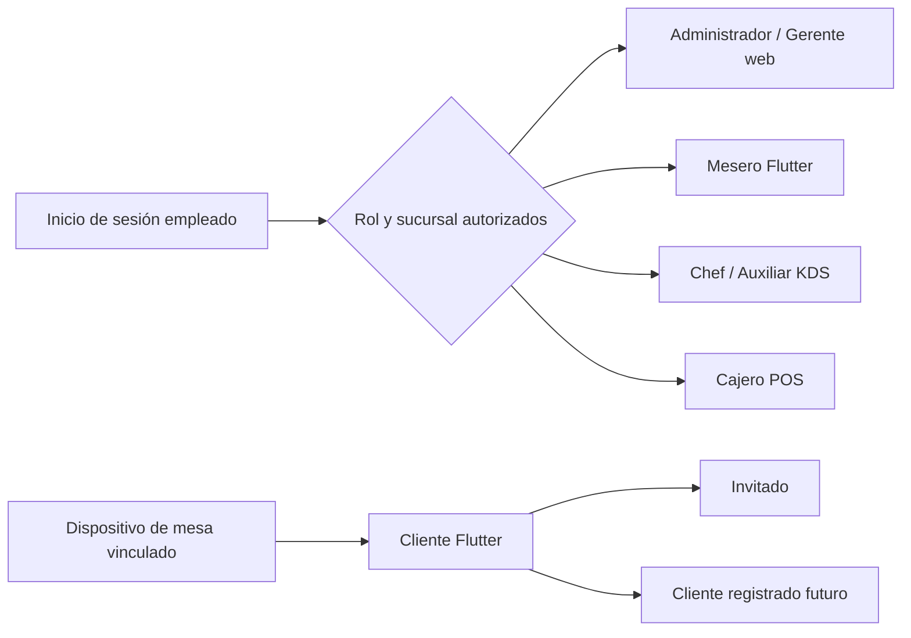
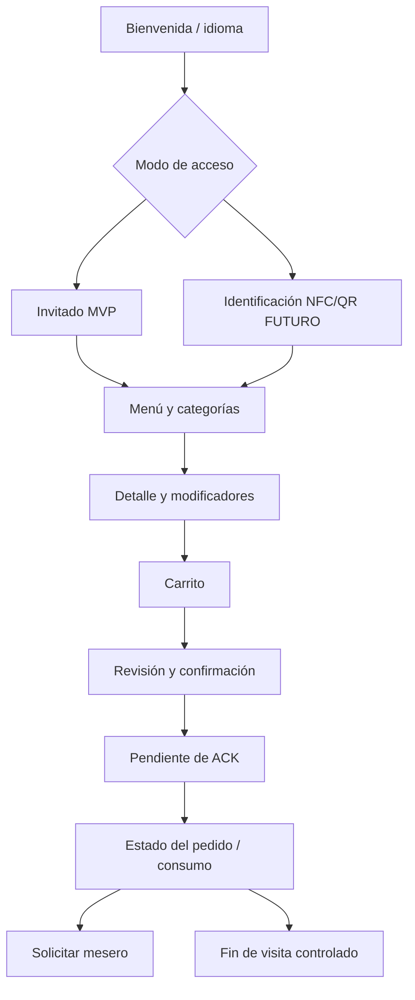

# Arquitectura de navegación — Fase 0.2

**Estado:** propuesta documental para wireframes; no implementa rutas ni cambia plataformas.

## Principios transversales

- Toda vista interna resuelve el alcance efectivo desde la sesión autorizada: `organization_id`, `branch_id`, rol y permiso. Ninguna ruta asume sucursal global.
- Las rutas nombran destinos UX, no endpoints ni permisos definitivos. El backend seguirá validando cada operación.
- Las acciones que cambian estado muestran confirmación solo después del ACK del servidor. En espera o sin servidor, se conserva el estado `pendiente/no confirmado`.
- Una interfaz solo expone destinos permitidos; ocultar un destino no sustituye RBAC.
- No hay navegación administrativa desde la tableta de mesa, KDS ni POS fuera del rol autenticado.

## Administrador web y gerente/supervisor

Patrón obligatorio: **navbar horizontal superior**. El primer nivel conserva: `Dashboard`, `Mesas`, `Pedidos`, `Menú`, `Personal`, `Cajas`, `Reportes`, `Ajustes`. No existe un sidebar administrativo permanente.

| Sección | Subpantallas propuestas | Administrador | Gerente / supervisor |
| --- | --- | --- | --- |
| Dashboard | resumen operativo, alertas, accesos recientes | lectura y configuración de panel | lectura según sucursal |
| Mesas | plano/lista, detalle de mesa, sesión, traslado, limpieza | administrar áreas/mesas y supervisar sesiones | supervisar; cambios según permiso |
| Pedidos | lista, detalle, historial, excepción/cancelación | consulta y acciones autorizadas | consulta y acciones autorizadas |
| Menú | categorías, producto, modificadores, disponibilidad | CRUD autorizado | CRUD si tiene permiso explícito |
| Personal | empleados, roles, horarios, turnos, auditoría | administrar | administrar solo ámbito delegado |
| Cajas | cajas, turno, movimientos, arqueo, cierre | consulta/supervisión y permisos especiales | consulta/supervisión según permiso |
| Reportes | ventas diarias, pedidos, mesas, cajas, productos | consulta/exportación futura autorizada | consulta limitada a su sucursal |
| Ajustes | organización, sucursal, estaciones, dispositivos, fiscal futura | administrar | solo parámetros concedidos |

Acciones de navegación: el navbar lleva a la lista o tablero de cada módulo; detalle abre una ruta contextual (`/mesas/:id`, por ejemplo); cancelar vuelve sin cambios; regreso conserva filtros cuando no haya mutación. El cambio de sucursal solo aparece para una sesión autorizada a más de una sucursal.

## Mesero — Flutter futuro

Jerarquía: `iniciar sesión → turno → salón → mesa → sesión de mesa → pedido/atención → salón`.

- **Salón:** plano/lista por área, estado físico y estado de sesión; no muestra datos de otras sucursales.
- **Mesa:** resumen de sesión, comensales, pedidos y solicitud del cliente; abre solo si el mesero tiene permiso y está asignado o autorizado.
- **Pedido:** composición, observaciones y revisión; el envío pasa a `pendiente de confirmación` hasta ACK.
- **Acciones contextualizadas:** abrir, trasladar, entregar, solicitar limpieza y cerrar solo con el permiso indicado en `OPERACIONES-CRITICAS.md`.

## Cliente en tableta Flutter Android

La tableta se vincula a una mesa mediante un proceso autorizado antes de mostrar la experiencia pública. Su árbol queda confinado a esa sesión:

Restricciones: no abrir configuración Android, panel administrativo, otra mesa, historial de otra persona ni operaciones de caja. El botón de regreso nunca abandona el alcance de la mesa. NFC/QR aparece como opción no disponible hasta su fase y no revela información de la credencial.

## Cocina KDS web

Patrón obligatorio: tablero oscuro horizontal con barra superior, selector de estación y columnas `Pendiente → En preparación → Listo`; `Entregado` se consulta como resultado de la entrega, sin obligar a abandonar el tablero.

- Barra: estación autorizada, conectividad, hora, silencio/reimpresión autorizada e historial de servicio.
- Columna: contador, tarjetas con mesa/orden, tiempo, ítems, alérgenos/observaciones y acción grande.
- Detalle lateral/modal: solo lectura ampliada sin perder columna ni filtro.
- Chef ve estaciones asignadas; auxiliar ve solo las estaciones y transiciones concedidas. No hay configuración de menú, caja ni empleados.

## Caja POS web

Patrón obligatorio: **rail lateral compacto** para navegación de caja y panel de resumen persistente. Jerarquía: `sesión de caja → mesas/cuentas → detalle → distribución futura → efectivo → propina → confirmación ACK → ticket → regreso`.

| Zona | Destinos | Restricción |
| --- | --- | --- |
| Rail lateral | inicio de caja, cuentas/mesas, movimientos autorizados, cierre, ajustes de sesión | no sustituye permisos; operaciones sensibles piden confirmación |
| Panel principal | lista de cuentas, detalle, forma de cobro, efectivo recibido, confirmación | tarjeta y otros proveedores no se muestran como confirmados |
| Resumen persistente | ítems, descuentos autorizados, impuestos configurados, propina, total y estado | datos del servidor; nunca recalcula ni confirma offline |

## Navegación prohibida y recuperación

| Contexto | Prohibido | Recuperación visible |
| --- | --- | --- |
| Sesión expirada | conservar o enviar mutaciones | volver a inicio, preservar borrador local marcado no confirmado cuando sea seguro |
| Permiso insuficiente | entrar o ejecutar acción restringida | pantalla/aviso de acceso denegado, volver al destino permitido anterior |
| Sin servidor/LAN | declarar orden, cobro, turno o cierre confirmado | indicador persistente, reintento manual y contingencia; no ocultar el estado |
| Conflicto concurrente | sobrescribir sesión, mesa o cierre ajeno | mostrar versión vigente, diferencias y acción de refrescar o cancelar |

La definición visual de cada destino y su relación con roles vive en `MAPA-PANTALLAS.md` y `ROLES-Y-DISPOSITIVOS.md`.
