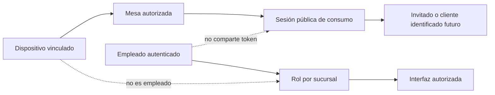

# Roles y dispositivos — Fase 0.2

## Principio de autoridad

El rol se autoriza por sucursal y operación. La interfaz adapta su navegación al permiso efectivo; el servidor PostgreSQL valida de nuevo. Un dispositivo no es un empleado y una tableta de mesa no recibe permisos administrativos.

| Actor | Ámbito y navegación | Puede iniciar | Restricciones explícitas |
| --- | --- | --- | --- |
| Administrador | Navbar completa de administración para sucursales autorizadas | configuración, menú, personal, auditoría, revisión de caja/reportes | no omite controles de acciones críticas ni reglas fiscales pendientes |
| Gerente | Misma jerarquía web, destinos filtrados por permiso | supervisión de salón, menú, turnos, reportes y excepciones autorizadas | no obtiene configuración global, descuentos o cierres si no tiene permiso |
| Cajero | Rail POS, cuentas/caja de su sucursal | apertura/cierre de caja, efectivo, propina, ticket | no confirma tarjeta sin proveedor; no altera menú/personal |
| Mesero | App Flutter: turno, salón, mesas y pedidos | abrir mesa autorizada, capturar pedido, entregar, pedir limpieza | no gestiona caja, roles, sucursales ni estaciones ajenas |
| Chef | KDS: estaciones asignadas y detalle de tickets | aceptar/preparar/listo según estación | no entrega financieramente, no abre mesas ni reimprime sin permiso |
| Auxiliar de cocina | KDS reducido por estación/acción | acciones expresamente concedidas | no reasigna estaciones ni accede a administración/caja |
| Cliente registrado | Tableta: menú, carrito, consumo propio; identificación posterior | consentimiento e identificación futura vía servidor | no recibe consola administrativa ni historial fuera de la sesión autorizada |
| Invitado | Tableta: menú, carrito, pedido, estado, atención | pedido atribuido a sesión/guest | no requiere datos personales ni acceso a otra mesa |
| Dispositivo de mesa | Identidad de dispositivo + mesa vinculada | presentar experiencia pública | no es usuario, no inicia sesión de empleado, no cambia mesa ni opera caja |

## Sesiones separadas

## Reglas de dispositivo de mesa

- El vínculo dispositivo–mesa requiere una operación autorizada y auditable; al liberarlo se invalida la sesión pública local.
- Solo se muestra el consumo y estado de la sesión activa de esa mesa. Si la sesión se cierra, se muestra fin de visita y se reinicia al estado seguro.
- NFC/QR no guarda PII en la etiqueta y no inicia una sesión sensible sin confirmación de servidor. Es **POSTERIOR**.
- Ante pérdida de LAN/servidor, puede conservar catálogo visual cacheado, pero no confirma pedidos, identificación ni cambios de consumo.

## Permisos que deben existir antes de habilitar UX

Los nombres son contratos de interfaz, no una taxonomía RBAC definitiva: `tables.open`, `tables.transfer`, `orders.modify_sent`, `orders.cancel`, `menu.manage`, `employees.manage`, `cash.open`, `cash.close`, `payments.cash`, `discounts.apply`, `tickets.reprint`, `devices.release`, `reports.read` y `audit.read`. La matriz final de quién los concede permanece configurable y se documenta como pendiente.
